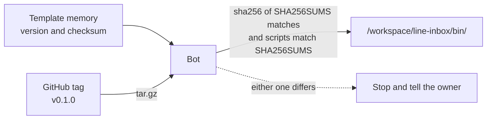

# grok-bot-line-desk

English | [日本語](README.md)

Scripts, skills and the routine used by the Grok Bot template "Desk for LINE". The bot logs inquiries that reach a LINE Official Account, notifies the owner and drafts replies. Nothing is sent to customers without the owner's OK.

A Grok Bot template cannot carry scripts, so they live here and are distributed by version. The relay that delivers LINE webhooks to the bot is [grok-bot-line-relay](https://github.com/keesmark/grok-bot-line-relay).

> This is an unofficial template made by an individual. It is not affiliated with, sponsored by or endorsed by xAI (now SpaceXAI) or LY Corporation. Grok is a trademark of SpaceXAI. LINE is a registered trademark or trademark of LY Corporation.

## Contents
- `scripts/`: 14 scripts using only the Python 3 standard library. They never send anything.
- `skills/`: the 8 skills, the same as in the template.
- `routines/line-webhook.md`: the prompt of the inbound routine 「LINE受信の記録」.
- `VERSION`: the version. The tag is `v` followed by VERSION (`0.1.0` → `v0.1.0`).
- `CHANGELOG.md`: changes per version.
- `MIGRATIONS.md`: manual steps when upgrading. The update skill reads it.
- `SHA256SUMS`: checksums of `scripts/`.
- `tools/`, `tests/`: for people changing this repository. They are not installed in the bot.

## Installing and verifying

The trust anchor is the 「照合値」 written in the template's memory (the sha256 of `SHA256SUMS` itself). The `SHA256SUMS` in this repository is not trusted on its own, because anyone who takes over the repository could rewrite it together with the scripts.



Normally the template's getting-started skill has the bot do the following. Installing by hand works the same way.

```sh
tmp=$(mktemp -d) && cd "$tmp"
curl -fsSL -o a.tgz https://github.com/keesmark/grok-bot-line-desk/archive/refs/tags/v0.1.0.tar.gz
tar -xzf a.tgz --strip-components=1
sha256sum SHA256SUMS                         # stop unless it equals the 「照合値」 in the template memory
(cd scripts && sha256sum -c ../SHA256SUMS)   # stop unless every line is OK
mkdir -p /workspace/line-inbox/bin
cp scripts/*.py VERSION SHA256SUMS /workspace/line-inbox/bin/
chmod 700 /workspace/line-inbox/bin/*.py
```

`/workspace/line-inbox/bin/` is shared by the bots on the same computer. If another version is already there, check before overwriting it. Always run the scripts as `DESK_DB=<this bot's database path> python3 /workspace/line-inbox/bin/<name>`.

## Checking the version and updating
- Installed version: `cat /workspace/line-inbox/bin/VERSION`. Unchanged contents: `cd /workspace/line-inbox/bin && sha256sum -c SHA256SUMS`.
- Latest version: `https://raw.githubusercontent.com/keesmark/grok-bot-line-desk/main/VERSION` and `CHANGELOG.md`. Ask the bot 「更新はある？」 and the update skill checks.
- Updates are never installed automatically. The update skill shows what changed and replaces the scripts only when the owner says 「更新」.

## Changing this repository

Tests use the standard library's unittest; coverage is measured with [coverage](https://pypi.org/project/coverage/).

```sh
python3 -m venv .venv
.venv/bin/pip install --require-hashes -r requirements-dev.txt
.venv/bin/coverage run -m unittest discover -s tests
.venv/bin/coverage report
```

After changing scripts or skills, run `python3 tools/sync.py`. It brings `SHA256SUMS`, the 「版：」 line of every skill and routine, and the tag in the download URLs of the READMEs and skills in line with `VERSION`. CI (`tools/sync.py --check`) fails when they are out of line.

Releasing:

1. Bump `VERSION` and add a `## v<version>` section to `CHANGELOG.md` and `MIGRATIONS.md` (write 「なし」 when there is nothing to do by hand).
2. Run `python3 tools/sync.py`, open a PR and merge it.
3. Tag the merged commit `v<version>` and create a Release.
4. Put the "SHA256SUMS sha256" printed by `tools/sync.py` in the template memory's 「照合値」 and the version in 「Desk for LINE の版」, then publish the template again.

## License

[MIT](LICENSE)
