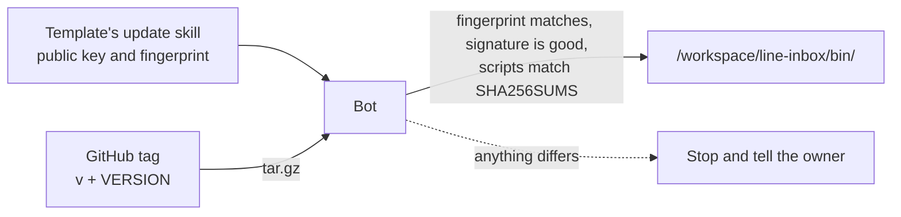

# grok-bot-line-desk

English | [日本語](README.md)

Scripts, skills and the routine used by the Grok Bot template "Desk for LINE". The bot logs inquiries that reach a LINE Official Account, notifies the owner and drafts replies. Nothing is sent to customers without the owner's OK.

A Grok Bot template cannot carry scripts, so they live here and are distributed by version. The relay that delivers LINE webhooks to the bot is [grok-bot-line-relay](https://github.com/keesmark/grok-bot-line-relay).

> This is an unofficial template made by an individual. It is not affiliated with, sponsored by or endorsed by xAI (now SpaceXAI) or LY Corporation. Grok is a trademark of SpaceXAI. LINE is a registered trademark or trademark of LY Corporation.

## Contents
- `scripts/`: 14 scripts using only the Python 3 standard library. They never send anything.
- `skills/`: the 8 skills, the same as in the template.
- `routines/line-webhook.md`: the prompt of the inbound routine 「LINE受信の記録」.
- `VERSION`: the version. The tag is `v` followed by VERSION (`0.1.0` → `v0.1.0`).
- `CHANGELOG.md`: changes per version.
- `MIGRATIONS.md`: manual steps when upgrading. The update skill reads it.
- `SHA256SUMS`: checksums of every file the bot receives (scripts, skills, routines, VERSION, CHANGELOG, MIGRATIONS). `SHA256SUMS.asc` is its signature.
- `keys/release.asc`: the public signing key (fingerprint `F136 EFC6 1A9D 8292 7C32  43EE 0FAD 4225 1453 DA94`). The update skill carries the same key.
- `tools/`, `tests/`: for people changing this repository. They are not installed in the bot.

## Installing and verifying

`SHA256SUMS` is signed with the author's (keesmark's) GPG key, and the bot checks the signature before installing. The public key and its fingerprint used for the check live in the template's update skill. Even if this repository were taken over, nobody can make a valid signature without the author's private key, so a fake version is not installed.



Normally the template's getting-started skill has the bot do the following. When installing by hand, take the public key from the template's update skill rather than from this repository, or check that its fingerprint is `F136 EFC6 1A9D 8292 7C32  43EE 0FAD 4225 1453 DA94`.

```sh
tmp=$(mktemp -d) && cd "$tmp"
curl -fsSL -o a.tgz https://github.com/keesmark/grok-bot-line-desk/archive/refs/tags/v0.1.0.tar.gz
tar -xzf a.tgz --strip-components=1
g=$(mktemp -d)
GNUPGHOME="$g" gpg --batch --quiet --import keys/release.asc
GNUPGHOME="$g" gpg --batch --with-colons --list-keys | awk -F: '/^fpr/{print $10; exit}'   # stop unless F136EFC61A9D82927C3243EE0FAD42251453DA94
GNUPGHOME="$g" gpg --batch --status-fd 1 --verify SHA256SUMS.asc SHA256SUMS 2>/dev/null | grep -cE '^\[GNUPG:\] (GOODSIG |VALIDSIG F136EFC61A9D82927C3243EE0FAD42251453DA94 )'   # stop unless it prints 2
sha256sum -c SHA256SUMS   # stop unless every line is OK
diff <(find scripts skills routines -type f | LC_ALL=C sort) <(awk '{print $2}' SHA256SUMS | grep -E '^(scripts|skills|routines)/' | LC_ALL=C sort)   # stop unless equal (a file outside the signature was added)
mkdir -p /workspace/line-inbox/bin
sed -n 's#^[0-9a-f]\{64\}  scripts/\([a-z_]*\.py\)$#\1#p' SHA256SUMS | while read -r f; do cp "scripts/$f" /workspace/line-inbox/bin/; done
cp VERSION SHA256SUMS SHA256SUMS.asc /workspace/line-inbox/bin/
chmod 700 /workspace/line-inbox/bin/*.py
rm -rf "$g"
```

`/workspace/line-inbox/bin/` is shared by the bots on the same computer. If another version is already there, check before overwriting it. Always run the scripts as `DESK_DB=<this bot's database path> python3 -I /workspace/line-inbox/bin/<name>`.

## Checking the version and updating
- Installed version: `cat /workspace/line-inbox/bin/VERSION`. Unchanged contents: `cd /workspace/line-inbox/bin && { sed -n 's#  scripts/#  #p' SHA256SUMS; grep '  VERSION$' SHA256SUMS; } | sha256sum -c`.
- Latest version: the latest [Release](https://github.com/keesmark/grok-bot-line-desk/releases/latest). `VERSION` on main is not used, since it may be bumped before the Release. Ask the bot 「更新はある？」 and the update skill checks.
- Updates are never installed automatically. The update skill shows what changed and replaces the scripts only when the owner says 「更新」.

## Changing this repository

Tests use the standard library's unittest; coverage is measured with [coverage](https://pypi.org/project/coverage/).

```sh
python3 -m venv .venv
.venv/bin/pip install --require-hashes -r requirements-dev.txt
.venv/bin/coverage run -m unittest discover -s tests
.venv/bin/coverage report
```

After changing scripts or skills, run `python3 tools/sync.py`. It brings `SHA256SUMS`, the 「版：」 line of every skill and routine, and the tag in the download URLs of the READMEs and skills in line with `VERSION`. CI (`tools/sync.py --check`) fails when they are out of line. When `SHA256SUMS` changes it must be signed again; CI (`tools/release.py --verify`) fails when the signature does not match.

Releasing:

1. Bump `VERSION` and add a `## v<version>` section to `CHANGELOG.md` and `MIGRATIONS.md` (write 「なし」 when there is nothing to do by hand).
2. On the author's computer, run `python3 tools/release.py` (it syncs and signs in one go; gpg asks for the passphrase). Open a PR and merge it.
3. Tag the merged commit `v<version>` and create a Release.
4. Set 「Desk for LINE の版」 in the template memory to the new version and publish the template again (existing users update through the update skill, so this is not required for them).

## License

[MIT](LICENSE)
