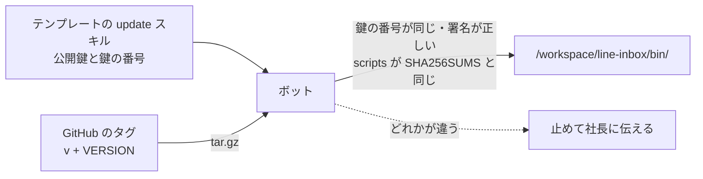

# grok-bot-line-desk

[English](README.en.md) | 日本語

Grok Bot のテンプレート「Desk for LINE」で使うスクリプト・スキル・ルーティンです。LINE公式アカウントに届いた問い合わせを、ボットが記録し、知らせ、返信案を作ります。お客様に送るのは社長のOKのあとだけです。

テンプレートにはスクリプトを入れられないため、ここに置いて版ごとに配ります。LINE の Webhook をボットに届ける中継は [grok-bot-line-relay](https://github.com/keesmark/grok-bot-line-relay) です。

> 個人が作った非公式のテンプレートです。xAI（現 SpaceXAI）や LINEヤフー株式会社とは関係がなく、提携や推奨も受けていません。Grok は SpaceXAI の商標です。LINE は LINEヤフー株式会社の登録商標または商標です。

## 中身
- `scripts/`：Python 3 の標準ライブラリだけのスクリプト 14 本。送信はしません。
- `skills/`：テンプレートと同じスキル 8 つ。
- `routines/line-webhook.md`：受信のルーティン「LINE受信の記録」のプロンプト。
- `VERSION`：版。タグは `v` と VERSION をつなげたものです（`0.1.0` → `v0.1.0`）。
- `CHANGELOG.md`：版ごとの変更。
- `MIGRATIONS.md`：版を上げるときに手でやる作業。update スキルが読みます。
- `SHA256SUMS`：ボットに入るファイル（scripts・skills・routines・VERSION・CHANGELOG・MIGRATIONS）の照合値。`SHA256SUMS.asc` はその署名です。
- `keys/release.asc`：署名の公開鍵（鍵の番号 `F136 EFC6 1A9D 8292 7C32  43EE 0FAD 4225 1453 DA94`）。update スキルの中にも同じ鍵があります。
- `tools/`、`tests/`：このリポジトリを直す人のためのもの。ボットには入れません。

## 入れ方と確かめ方

`SHA256SUMS` は作者（keesmark）の GPG の鍵で署名してあり、ボットは署名を確かめてから入れます。確かめに使う公開鍵と鍵の番号は、テンプレートの update スキルの中にあります。このリポジトリが乗っ取られても、作者の秘密鍵がなければ署名は作れないので、偽の版は入りません。



ふつうはテンプレートの getting-started スキルが、ボットに次のことをさせます。手で入れるときは、公開鍵をこのリポジトリではなくテンプレートの update スキルから取るか、鍵の番号が `F136 EFC6 1A9D 8292 7C32  43EE 0FAD 4225 1453 DA94` であることを確かめてください。

```sh
tmp=$(mktemp -d) && cd "$tmp"
curl -fsSL -o a.tgz https://github.com/keesmark/grok-bot-line-desk/archive/refs/tags/v0.1.0.tar.gz
tar -xzf a.tgz --strip-components=1
g=$(mktemp -d)
GNUPGHOME="$g" gpg --batch --quiet --import keys/release.asc
GNUPGHOME="$g" gpg --batch --with-colons --list-keys | awk -F: '/^fpr/{print $10; exit}'   # F136EFC61A9D82927C3243EE0FAD42251453DA94 でなければ止める
GNUPGHOME="$g" gpg --batch --status-fd 1 --verify SHA256SUMS.asc SHA256SUMS 2>/dev/null | grep -cE '^\[GNUPG:\] (GOODSIG |VALIDSIG F136EFC61A9D82927C3243EE0FAD42251453DA94 )'   # 2 でなければ止める
sha256sum -c SHA256SUMS   # 全部 OK でなければ止める
diff <(find scripts skills routines -type f | LC_ALL=C sort) <(awk '{print $2}' SHA256SUMS | grep -E '^(scripts|skills|routines)/' | LC_ALL=C sort)   # 同じでなければ止める（署名にないファイルが混ざっている）
find . ! -type f ! -type d   # 何か出たら止める（リンクが混ざっている）
mkdir -p /workspace/line-inbox/bin
sed -n 's#^[0-9a-f]\{64\}  scripts/\([a-z_]*\.py\)$#\1#p' SHA256SUMS | while read -r f; do cp "scripts/$f" /workspace/line-inbox/bin/; done
cp VERSION SHA256SUMS SHA256SUMS.asc /workspace/line-inbox/bin/
chmod 700 /workspace/line-inbox/bin/*.py
rm -rf "$g"
```

`/workspace/line-inbox/bin/` は同じコンピューターのボットで共有です。すでに別の版が入っていたら、上書きする前に確かめてください。スクリプトはいつも `DESK_DB=<このボットの保存先> python3 -I /workspace/line-inbox/bin/<名前>` で動かします。

## 版の確かめ方と更新
- 入っている版：`cat /workspace/line-inbox/bin/VERSION`。中身が変わっていないか：`cd /workspace/line-inbox/bin && { sed -n 's#  scripts/#  #p' SHA256SUMS; grep '  VERSION$' SHA256SUMS; } | sha256sum -c`。
- 新しい版：最新の [Release](https://github.com/keesmark/grok-bot-line-desk/releases/latest)。main の `VERSION` は Release の前に上がることがあるので見ません。ボットに「更新はある？」と聞くと、update スキルが確かめます。
- 更新は自動では入りません。update スキルが変更点を見せ、社長が「更新」と言ったときだけ入れ替えます。

## 直すとき（このリポジトリを直す人へ）

テストは Python 3 の標準ライブラリの unittest で、カバレッジは [coverage](https://pypi.org/project/coverage/) で測ります。

```sh
python3 -m venv .venv
.venv/bin/pip install --require-hashes -r requirements-dev.txt
.venv/bin/coverage run -m unittest discover -s tests
.venv/bin/coverage report
```

スクリプトやスキルを直したら、`python3 tools/sync.py` で `SHA256SUMS`、スキルとルーティンの「版：」の行、README とスキルのダウンロード URL のタグを、`VERSION` にそろえます。そろっていないと CI（`tools/sync.py --check`）が落ちます。`SHA256SUMS` が変わったら署名もし直す必要があり、署名が合っていないと CI（`tools/release.py --verify`）が落ちます。

版を出す手順：

1. `VERSION` を上げ、`CHANGELOG.md` と `MIGRATIONS.md` に `## v<版>` の節を足す（手作業がなければ「なし」）。
2. 作者の PC で `python3 tools/release.py` を実行する（そろえ直しと署名をまとめて行い、gpg がパスフレーズを聞きます）。PR にしてマージする。
3. マージしたコミットにタグ `v<版>` を付け、Release を作る。
4. テンプレートのメモリの「Desk for LINE の版」を新しい版にし、テンプレートを出し直す（すでに使っている人は update スキルで更新するので、出し直さなくても動きます）。

## ライセンス

[MIT](LICENSE)
