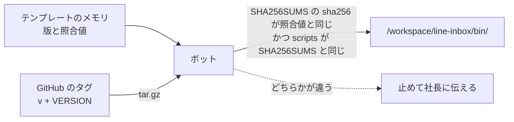

# grok-bot-line-desk

[English](README.en.md) | 日本語

Grok Bot のテンプレート「Desk for LINE」で使うスクリプト・スキル・ルーティンです。LINE公式アカウントに届いた問い合わせを、ボットが記録し、知らせ、返信案を作ります。お客様に送るのは社長のOKのあとだけです。

テンプレートにはスクリプトを入れられないため、ここに置いて版ごとに配ります。LINE の Webhook をボットに届ける中継は [grok-bot-line-relay](https://github.com/keesmark/grok-bot-line-relay) です。

> 個人が作った非公式のテンプレートです。xAI（現 SpaceXAI）や LINEヤフー株式会社とは関係がなく、提携や推奨も受けていません。Grok は SpaceXAI の商標です。LINE は LINEヤフー株式会社の登録商標または商標です。

## 中身
- `scripts/`：Python 3 の標準ライブラリだけのスクリプト 14 本。送信はしません。
- `skills/`：テンプレートと同じスキル 8 つ。
- `routines/line-webhook.md`：受信のルーティン「LINE受信の記録」のプロンプト。
- `VERSION`：版。タグは `v` と VERSION をつなげたものです（`0.1.0` → `v0.1.0`）。
- `CHANGELOG.md`：版ごとの変更。
- `MIGRATIONS.md`：版を上げるときに手でやる作業。update スキルが読みます。
- `SHA256SUMS`：`scripts/` の照合値。
- `tools/`、`tests/`：このリポジトリを直す人のためのもの。ボットには入れません。

## 入れ方と照合

照合の基準は、テンプレートのメモリに書いてある「照合値」（`SHA256SUMS` 自体の sha256）です。このリポジトリの `SHA256SUMS` は、リポジトリが乗っ取られると中身と一緒に書き換えられるので、それだけでは信用しません。



ふつうはテンプレートの getting-started スキルが、ボットに次のことをさせます。手で入れるときも同じです。

```sh
tmp=$(mktemp -d) && cd "$tmp"
curl -fsSL -o a.tgz https://github.com/keesmark/grok-bot-line-desk/archive/refs/tags/v0.1.0.tar.gz
tar -xzf a.tgz --strip-components=1
sha256sum SHA256SUMS                         # テンプレートのメモリの「照合値」と同じでなければ止める
(cd scripts && sha256sum -c ../SHA256SUMS)   # 全部 OK でなければ止める
mkdir -p /workspace/line-inbox/bin
cp scripts/*.py VERSION SHA256SUMS /workspace/line-inbox/bin/
chmod 700 /workspace/line-inbox/bin/*.py
```

`/workspace/line-inbox/bin/` は同じコンピューターのボットで共有です。すでに別の版が入っていたら、上書きする前に確かめてください。スクリプトはいつも `DESK_DB=<このボットの保存先> python3 /workspace/line-inbox/bin/<名前>` で動かします。

## 版の確かめ方と更新
- 入っている版：`cat /workspace/line-inbox/bin/VERSION`。中身が変わっていないか：`cd /workspace/line-inbox/bin && sha256sum -c SHA256SUMS`。
- 新しい版：最新の [Release](https://github.com/keesmark/grok-bot-line-desk/releases/latest)。main の `VERSION` は Release の前に上がることがあるので見ません。ボットに「更新はある？」と聞くと、update スキルが確かめます。
- 更新は自動では入りません。update スキルが変更点を見せ、社長が「更新」と言ったときだけ入れ替えます。

## 直すとき（このリポジトリを直す人へ）

テストは Python 3 の標準ライブラリの unittest で、カバレッジは [coverage](https://pypi.org/project/coverage/) で測ります。

```sh
python3 -m venv .venv
.venv/bin/pip install --require-hashes -r requirements-dev.txt
.venv/bin/coverage run -m unittest discover -s tests
.venv/bin/coverage report
```

スクリプトやスキルを直したら、`python3 tools/sync.py` で `SHA256SUMS`、スキルとルーティンの「版：」の行、README とスキルのダウンロード URL のタグを、`VERSION` にそろえます。そろっていないと CI（`tools/sync.py --check`）が落ちます。

版を出す手順：

1. `VERSION` を上げ、`CHANGELOG.md` と `MIGRATIONS.md` に `## v<版>` の節を足す（手作業がなければ「なし」）。
2. `python3 tools/sync.py` を実行し、PR にしてマージする。
3. マージしたコミットにタグ `v<版>` を付け、Release を作る。
4. `tools/sync.py` が出した「SHA256SUMS sha256」を、テンプレートのメモリの「照合値」に、版を「Desk for LINE の版」に書き、テンプレートを出し直す。

## ライセンス

[MIT](LICENSE)
